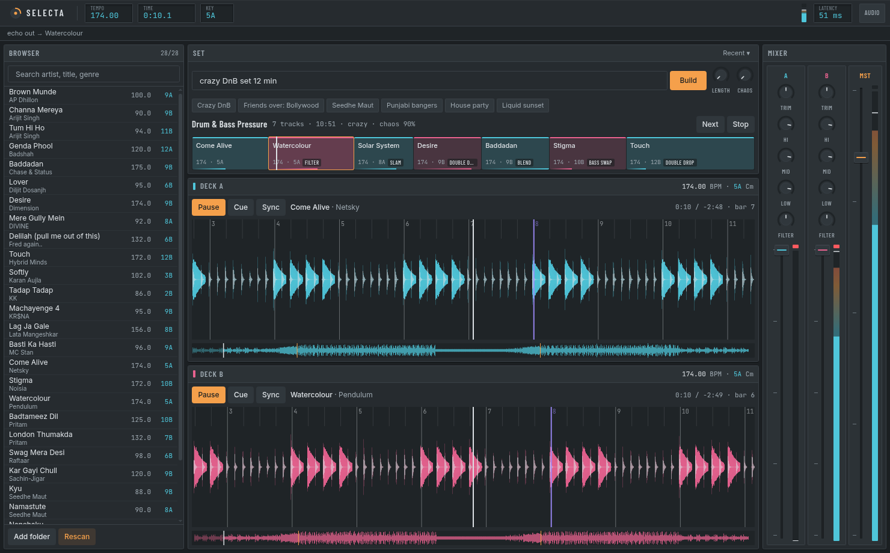

# Selecta

A local, AI-driven DJ. Describe the set you want ("crazy DnB", "friends are
coming, Bollywood", "Seedhe Maut hip hop") and Selecta builds and performs it
from your own music library: beatmatched, phrase-aware transitions,
stem-aware effects with a reason behind every one, keylock, and lyrics synced
to what is actually playing.

Native desktop app: **Tauri 2 shell + Rust core + React UI**. Everything runs
on your machine.

> **Status:** foundation plus the set planner. Describe a set and Selecta
> picks, orders and performs it: beatmatched blends, bass swaps, double drops,
> filter mixes, echo-outs and slams on phrase boundaries. AI curation, the FX
> director, lyrics, Spotify, stems and keylock follow: see
> [docs/ROADMAP.md](docs/ROADMAP.md).



## Run it

Prerequisites: Rust (stable), Node 24+, and on Linux the Tauri system libraries
(`webkit2gtk-4.1`, `gtk3`, `librsvg`).

```sh
npm install
npm run dev        # the desktop app, with hot reload
npm run build      # installers for this OS (AppImage/deb/rpm, NSIS, dmg)
./scripts/install-local.sh   # Linux: build this checkout and install/update it in your app menu
```

UI work without the Rust build: `npm run dev:ui`, then open
`http://localhost:1420/?mock` (see `apps/ui/src/dev/mock-backend.ts`).

## Repository

```
crates/selecta-core     Rust: decode, analysis, library (SQLite), job scheduler. No Tauri, ever.
apps/desktop/src-tauri  Rust: Tauri shell, thin async commands over the core
apps/ui                 React + TypeScript + Vite + Tailwind v4, dsgn components, "Studio" voice
packages/engine         TypeScript: Web Audio decks, mixer, beat-grid maths. No React, ever.
packages/protocol       TypeScript types generated from the Rust structs (ts-rs)
```

- [docs/ARCHITECTURE.md](docs/ARCHITECTURE.md): how the pieces fit, and why
- [docs/DESIGN.md](docs/DESIGN.md): the FL-Studio-inspired design principles and tokens
- [docs/ROADMAP.md](docs/ROADMAP.md): what's next, PR by PR

## Checks

```sh
npm run check                    # eslint + typecheck + vitest
cargo test --workspace           # core analysis, scheduler, library
cargo clippy --workspace --all-targets -- -D warnings
npm run protocol                 # regenerate TS types after changing a Rust type
```

Contributions go through pull requests: `main` is protected.

## License

MIT
